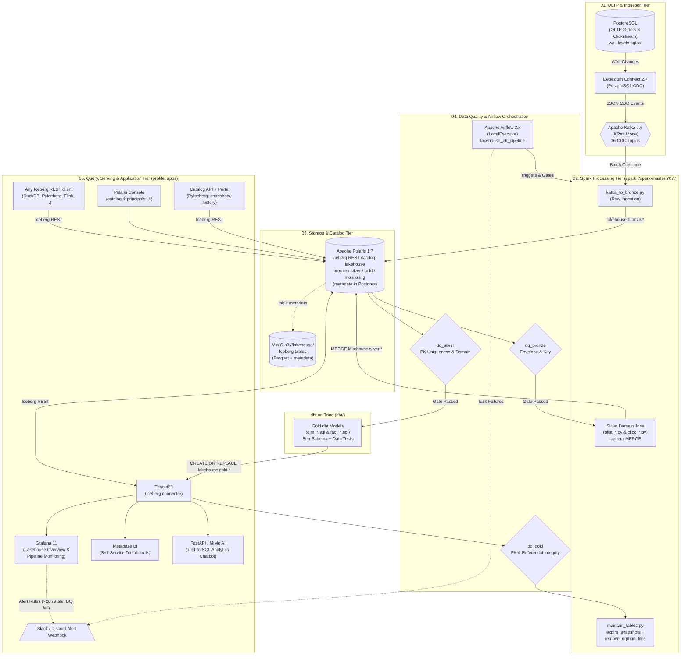

# 🌊 Production-Grade Lakehouse Platform (Docker Compose Edition)

[](https://spark.apache.org/)
[](https://iceberg.apache.org/)
[](https://polaris.apache.org/)
[](https://airflow.apache.org/)
[](https://trino.io/)
[](https://kafka.apache.org/)
[](https://debezium.io/)
[](https://min.io/)
[](https://grafana.com/)
[](https://fastapi.tiangolo.com/)
[](https://docs.docker.com/compose/)
[](https://www.python.org/)

An enterprise-grade, local **Medallion Lakehouse platform** (Bronze → Silver → Gold) engineered for high-throughput **Change Data Capture (CDC)**, transactional table management, automated data governance, and full-stack analytics.

This repository provides an autonomous, developer-friendly **Docker Compose** implementation—completely eliminating Kubernetes control-plane overhead while preserving a cloud-native architecture, production-grade quality gates, a single open **Apache Iceberg** catalog (**Apache Polaris**) shared by every engine, and end-to-end pipeline observability.

---

## 📑 Table of Contents

- [System Architecture](#-system-architecture)
- [Key Features](#-key-features)
- [Medallion Data Architecture](#-medallion-data-architecture)
  - [Layer Design & Table Registry](#layer-design--table-registry)
  - [Dimensional Data Modeling (Gold Layer)](#dimensional-data-modeling-gold-layer)
- [Core Engineering Deep Dives](#-core-engineering-deep-dives)
  - [1. Incremental Silver Upserts & Iceberg Snapshots](#1-incremental-silver-upserts--iceberg-snapshots)
  - [2. Multi-Layer Data Quality Gates](#2-multi-layer-data-quality-gates)
  - [3. One Iceberg Catalog for Every Engine (Apache Polaris)](#3-one-iceberg-catalog-for-every-engine-apache-polaris)
  - [4. Observability & Webhook Alerting](#4-observability--webhook-alerting)
  - [5. Natural Language Analytics Chatbot](#5-natural-language-analytics-chatbot)
  - [6. Unified Data Portal & Interactive Lineage](#6-unified-data-portal--interactive-lineage)
- [Services & Port Matrix](#-services--port-matrix)
- [Getting Started](#-getting-started)
  - [Prerequisites](#prerequisites)
  - [Quick Start in 5 Minutes](#quick-start-in-5-minutes)
  - [Enabling the BI & Application Tier](#enabling-the-bi--application-tier)
  - [Querying from Other Engines (DuckDB, PyIceberg, ...)](#querying-from-other-engines-duckdb-pyiceberg-)
  - [Migrating an Existing Delta / Unity Catalog Install](#migrating-an-existing-delta--unity-catalog-install)
- [Developer Workflow & Operations](#-developer-workflow--operations)
  - [Live Code Bind-Mounts](#live-code-bind-mounts)
  - [Common Docker Compose Commands](#common-docker-compose-commands)
  - [Adding a New Table to the Lakehouse](#adding-a-new-table-to-the-lakehouse)
  - [Static Layout & Quality Gate Checks](#static-layout--quality-gate-checks)
  - [Automated Testing Suite](#automated-testing-suite)
- [CI/CD & Container Image Publishing](#-cicd--container-image-publishing)
- [Project Directory Layout](#-project-directory-layout)

---

## 🏗️ System Architecture



---

## ⚡ Key Features

| Capability | Engineering Highlight |
|---|---|
| **Zero-Friction Local Dev** | Source code (`spark/app`, `airflow/dags`, `api/`) is bind-mounted directly. Edit code on your host, run tasks immediately without rebuilding Docker images. |
| **Full Medallion Pipeline** | Bronze (raw CDC envelope), Silver (cleaned, normalized domain models), and Gold (Kimball star schema dimensional marts). |
| **Incremental Silver MERGE** | Business-key upsert into **Apache Iceberg** tables. Unchanged records are untouched (`processed_at` preserved); every run is one Iceberg snapshot, so row-level inserts / updates / deletes can be read back with Iceberg's changelog view and any snapshot can be queried by time travel. |
| **Multi-Stage Data Quality Gates** | Airflow execution halts if data quality fails (`dq_bronze`, `dq_silver`, `dq_gold`). Results are logged to an audit Iceberg table with strict failure thresholds (`> 5%` violation rate). |
| **One Open Catalog** | **Apache Polaris** (Iceberg REST) is the single catalog `lakehouse` for Spark, Trino/dbt, PyIceberg, DuckDB and any other Iceberg client. A table is visible to every engine the moment it is written: no registration step, no second metastore. |
| **Enterprise Observability** | Automatic capture of row-level write statistics (`rows_inserted`, `rows_updated`, `rows_deleted`) and DQ logs in `lakehouse.monitoring.*`, read by Grafana through Trino; Iceberg snapshot history in the portal. |
| **Proactive Alerting** | Slack/Discord webhook alerts triggered on Airflow task failures and Grafana alerting rules (stale tables > 26h, failed jobs, DQ rule breaches). |
| **Generative AI Chatbot** | FastAPI app with Xiaomi MiMo LLM (`mimo-v2.5`), enabling conversational Text-to-SQL queries directly against Trino Gold tables. |

---

## 📊 Medallion Data Architecture

### Layer Design & Table Registry

Every table in the platform is managed through a single central registry in [`spark/app/common/tables.py`](spark/app/common/tables.py) (layer → table → Iceberg identifier `lakehouse.<layer>.<table>`), ensuring jobs, DQ validation, and table maintenance never drift apart.

```
┌────────────────────────────────────────────────────────────────────────────────────────────────────────┐
│                                       MEDALLION DATA FLOW                                              │
├──────────────────────────┬─────────────────────────────────────┬───────────────────────────────────────┤
│       BRONZE LAYER       │            SILVER LAYER             │              GOLD LAYER               │
│      Raw CDC Logs        │      Cleaned Domain Entities        │       Dimensional Marts (Star)        │
├──────────────────────────┼─────────────────────────────────────┼───────────────────────────────────────┤
│ • olist_orders           │ • olist_orders                      │ • dim_date                            │
│ • olist_customers        │ • olist_customers                   │ • dim_customer                        │
│ • olist_geolocation      │ • olist_sellers                     │ • dim_seller                          │
│ • olist_order_items      │ • olist_products                    │ • dim_product                         │
│ • olist_order_payments   │ • olist_order_items                 │ • dim_device                          │
│ • olist_order_reviews    │ • olist_order_payments              │ • dim_traffic_source                  │
│ • olist_products         │ • olist_order_reviews               │ • dim_click_customer                  │
│ • olist_sellers          │ • click_customers                   │ • dim_click_product                   │
│ • product_category_trans │ • click_products                    │ • fact_orders                         │
│ • click_customers        │ • click_sessions                    │ • fact_reviews                        │
│ • click_products         │ • click_orders                      │ • fact_click_orders                   │
│ • click_sessions         │ • click_order_items                 │ • fact_sessions                       │
│ • click_orders           │ • click_events                      │ • fact_clickstream_events             │
│ • click_order_items      │ • click_reviews                     │ • fact_click_reviews                  │
│ • click_events           │                                     │                                       │
│ • click_reviews          │                                     │                                       │
├──────────────────────────┼─────────────────────────────────────┼───────────────────────────────────────┤
│ lakehouse.bronze.*       │ lakehouse.silver.*                  │ lakehouse.gold.*                      │
│ Format: Iceberg v2       │ Format: Iceberg v2 (snapshots)      │ Format: Iceberg v2 (written by Trino) │
│ Mode: Kafka CDC Snapshot │ Mode: MERGE Upsert (SILVER_KEYS)    │ Mode: Full Dimensional Rebuild        │
└──────────────────────────┴─────────────────────────────────────┴───────────────────────────────────────┘
```

### Dimensional Data Modeling (Gold Layer)

The Gold layer transforms domain entities into high-performance Kimball Star Schemas:
- **Built with dbt on Trino**: Every dimension and fact is a dbt model in [`dbt/models/`](dbt/models/) (`dbt-trino`), written as `CREATE OR REPLACE TABLE lakehouse.gold.<table>` through Trino's Iceberg connector straight into Polaris, so each run is a new Iceberg snapshot of the same table (history and time travel preserved). `dbt build` runs the models in dependency order together with their data tests (unique / not-null keys, FK relationships, accepted values, unknown-member ratio).
- **Surrogate Keys**: Deterministic `BIGINT` keys (`hash_key` macro: `xxhash64` over the natural business key), stable across full rebuilds.
- **Handling Unknown / Late-Arriving Dimensions**: Failed foreign key lookups gracefully resolve to standard unknown member records (`-1`), preventing query joins from silently dropping metric values.
- **Analytical Use Cases**:
  - `fact_orders`: Order sales metrics, freight costs, payment counts, approval-to-delivery durations.
  - `fact_sessions` & `fact_clickstream_events`: Funnel conversion analysis, bounce rates, session durations, device and traffic attribution.
  - `fact_reviews`: Customer sentiment trends, fulfillment satisfaction, review scores by seller and product category.

---

## 🔍 Core Engineering Deep Dives

### 1. Incremental Silver Upserts & Iceberg Snapshots

Instead of expensive full-table overwrites, Silver tables are updated via `upsert_with_metrics` ([`spark/app/common/writers.py`](spark/app/common/writers.py)):

1. **MERGE Strategy**: the desired table state is merged into the Iceberg table on its business key (`SILVER_KEYS`):
   - **`WHEN MATCHED AND xxhash64(target) <> xxhash64(source)`** $\rightarrow$ `UPDATE SET *` (audit columns such as `processed_at` are left out of the hash)
   - **`WHEN NOT MATCHED`** $\rightarrow$ `INSERT *`
   - **`WHEN NOT MATCHED BY SOURCE`** $\rightarrow$ `DELETE` (the key vanished upstream)
2. **Timestamp Preservation**: If attributes are identical, records are **not rewritten**, preserving the original `processed_at` timestamp as a true "last modified" audit attribute.
3. **Snapshots & Changes**: every write is one Iceberg snapshot. `read_changes(spark, table, keys, start_snapshot_id)` wraps Iceberg's `create_changelog_view` and returns the exact row changes (`INSERT`, `UPDATE_BEFORE` / `UPDATE_AFTER`, `DELETE`) with their snapshot ids; `spark.read.option("snapshot-id", ...)` in Spark or `FOR VERSION AS OF` in Trino time-travels to any snapshot.
4. **Metrics Instrumentation**: Each execution appends a record to `lakehouse.monitoring.pipeline_metrics` tracking `rows_inserted`, `rows_updated`, `rows_deleted`, `write_mode`, and duration.
5. **Maintenance**: `maintain_iceberg_tables`, the last task of `lakehouse_etl_pipeline` ([`jobs/ops/maintain_tables.py`](spark/app/jobs/ops/maintain_tables.py)), expires snapshots older than 7 days (keeping the last 5), removes orphan files and rewrites manifests for every table, including the Trino-written gold tables.

### 2. Multi-Layer Data Quality Gates

Data Quality is enforced as blocking DAG gates (`jobs/ops/data_quality.py`). If more than **5%** of records in a table violate any assertion rule, the job exits with code `1`, immediately halting downstream stages.

```
Airflow DAG Execution
 ├── Kafka to Bronze
 │    └── [GATE: dq_bronze] ────► Fails if envelope malformed or keys null
 ├── Bronze to Silver (14 sequential jobs)
 │    └── [GATE: dq_silver] ────► Fails on duplicate PKs or domain enum violations
 └── Silver to Gold (dbt build: 14 models + data tests on Trino)
      └── [GATE: dq_gold] ──────► Fails on unresolved FKs (>5% fallback to -1)
           └── maintain_iceberg_tables ──► Expires snapshots, removes orphan files
```

- **Bronze Checks**: CDC envelope verification (`op` in `c, r, u, d`, valid timestamps `ts_ms > 0`), valid payload fields (`after` not null unless delete), non-null business identifiers.
- **Silver Checks**: Primary key uniqueness and non-nullability; domain-specific bounds (e.g. `price > 0`, valid geolocation ranges, review scores `[1, 5]`, allowed order statuses).
- **Gold Checks**: Surrogate key integrity, non-negative fact metrics, and referential integrity (foreign key joins must resolve without excessive fallback to `-1`).
- **Audit Log**: Every check result is appended to the Iceberg table `lakehouse.monitoring.data_quality_log`, queryable from Trino / Grafana as soon as it is written.

### 3. One Iceberg Catalog for Every Engine (Apache Polaris)

All tables are **Apache Iceberg** (spec v2) tables in one **Apache Polaris** catalog, `lakehouse`, served over the standard Iceberg REST API:

1. **Polaris** (`polaris`, port `8181`; health on `8182`):
   - Metadata persists in the `polaris` database of the stack's PostgreSQL (`relational-jdbc`); `polaris-bootstrap` creates the realm and the root principal (`POLARIS_ROOT_CLIENT_ID` / `POLARIS_ROOT_CLIENT_SECRET` in `.env`) on first start.
   - [`polaris/init.sh`](polaris/init.sh) (service `polaris-init`, idempotent) creates the catalog on `s3://lakehouse/`, grants `CATALOG_MANAGE_CONTENT`, and creates the namespaces `bronze`, `silver`, `gold`, `monitoring`. Tables land under `s3://lakehouse/<namespace>/<table>`.
   - No credential vending (`stsUnavailable`): Polaris writes table metadata with its own MinIO key, and every engine reads/writes data files with its own MinIO keys. Only `endpointInternal` is set, so each client keeps its own MinIO address (`minio:9000` in Docker, `localhost:9000` on the host).
2. **Spark** uses Iceberg's `SparkCatalog` (`type=rest`, OAuth2 client credentials, `S3FileIO`), configured in [`common/config.py`](spark/app/common/config.py). Jobs address tables by identifier (`lakehouse.silver.olist_orders`), never by path.
3. **Trino** uses its Iceberg connector against the same catalog ([`trino/catalog/lakehouse.properties`](trino/catalog/lakehouse.properties), credentials from the environment). dbt builds gold through it; Grafana, Metabase, the chatbot and the catalog API query `lakehouse.<schema>.<table>`.
4. **Everything else** that speaks Iceberg REST connects the same way: the catalog API (PyIceberg), the **Polaris Console** (`apps` profile, port `8088`), DuckDB and PyIceberg on the host (see [Querying from Other Engines](#querying-from-other-engines-duckdb-pyiceberg-)), or Flink, Snowflake, StarRocks and Dremio.

### 4. Observability & Webhook Alerting

The platform includes production-ready monitoring and alerting provisioned out of the box:

- **Pipeline Monitoring Dashboard** (Grafana, `http://localhost:3001`):
  - **Freshness Gauge**: Flags tables where last successful commit is older than 26 hours.
  - **Execution Trends**: Tracks step-by-step job runtime duration across layers.
  - **MERGE Activity**: Visualizes rows inserted vs. updated vs. deleted over time.
  - **Data Quality**: Real-time pass/fail rates, assertion breaches, and error summaries.
- **Lakehouse Business Overview Dashboard**:
  - E-Commerce revenue by Brazilian state, category performance, order fulfillment lead time.
  - Clickstream conversion funnels, bounce rates, device and traffic distribution.
- **Webhook Alerting Integration**:
  - Configure `ALERT_WEBHOOK_URL` in `.env` (compatible with Slack, Discord `/slack`, Mattermost).
  - Airflow triggers instant notifications on task failure via [`airflow/dags/alerting.py`](file:///d:/Projects/lakehouse_docker/airflow/dags/alerting.py).
  - Grafana alert rules actively monitor table freshness and DQ breach thresholds.

### 5. Natural Language Analytics Chatbot

An integrated AI assistant running under the `apps` profile:
- Built with **FastAPI** and styled with modern dark-mode UI ([`api/`](file:///d:/Projects/lakehouse_docker/api)).
- Powered by **Xiaomi MiMo LLM** (`mimo-v2.5` via OpenAI-compatible API).
- Translates natural language questions into valid Trino SQL targeting `lakehouse.gold.*` tables.
- Validates queries, enforces `SELECT`-only execution, and formats executive business summaries with tabular data.

### 6. Unified Data Portal & Interactive Lineage

A modern single-page web portal running on port `3002` under the `apps` profile ([`portal/`](file:///d:/Projects/lakehouse_docker/portal)):
- **Data Catalog**: Searchable table directory across Bronze, Silver, and Gold layers with metadata, descriptions, primary keys, and data quality pass/fail scores.
- **Table Inspector**: Detailed column schema, data types, foreign key relationships, live row counts, sample data, the Iceberg location, and the table's **snapshot history** (operation, added / deleted / total records), read from Polaris with PyIceberg by the catalog API (`/tables/{layer}/{table}/snapshots`, `/history`, `/properties`).
- **Interactive DAG Lineage**: Visual React Flow graph mapping data progression from PostgreSQL sources → Debezium CDC → Bronze Iceberg → Silver Domain Entities → Gold Dimensions & Facts.
- **Embedded LakeBot**: Conversational analytics interface with real-time Chart.js visualizer, syntax-highlighted SQL blocks, and one-click query execution.

---

## 🖥️ Services & Port Matrix

| Service | Host Port | Internal Port | Purpose | Default Credentials |
|---|---|---|---|---|
| **Airflow Webserver** | [localhost:8084](http://localhost:8084) | `8080` | DAG orchestration & pipeline tracking | `airflow` / `airflow` |
| **Spark Master UI** | [localhost:8080](http://localhost:8080) | `8080` | Spark cluster & job execution status | — |
| **Trino Coordinator** | [localhost:8081](http://localhost:8081) | `8080` | Distributed SQL query engine | `admin` (no password) |
| **Polaris (Iceberg REST)** | [localhost:8181](http://localhost:8181/api/catalog/v1/config?warehouse=lakehouse) | `8181` | Iceberg catalog `lakehouse` for every engine (health: `:8182/q/health`) | `root` / `POLARIS_ROOT_CLIENT_SECRET` |
| **Kafka Connect API** | [localhost:8083](http://localhost:8083) | `8083` | Debezium CDC connectors manager | — |
| **MinIO Console** | [localhost:9001](http://localhost:9001) | `9001` | S3 bucket & object browser | `admin` / `password123` |
| **MinIO S3 API** | `localhost:9000` | `9000` | S3 object storage gateway | `admin` / `password123` |
| **PostgreSQL** | `localhost:5432` | `5432` | OLTP source database (`orders`) | `postgres` / `123456` |
| **Apache Kafka** | `localhost:29092` | `9092` | KRaft distributed event broker | — |
| **Metabase** *(apps)* | [localhost:3000](http://localhost:3000) | `3000` | Business intelligence & visualizations | Initial setup on first visit |
| **Grafana** *(apps)* | [localhost:3001](http://localhost:3001) | `3000` | Pre-provisioned dashboards & alerts | `admin` / `admin` |
| **Lakehouse Portal** *(apps)* | [localhost:3002](http://localhost:3002) | `80` | Unified catalog, interactive lineage & LakeBot | — |
| **Catalog API** *(apps)* | [localhost:8087](http://localhost:8087) | `8000` | Metadata catalog, lineage & search API | — |
| **Kafka UI** *(apps)* | [localhost:8085](http://localhost:8085) | `8080` | Topic message & consumer inspector | — |
| **FastAPI / Chatbot** *(apps)* | [localhost:8000](http://localhost:8000) (API only, UI is in the portal) | `8000` | SQL API & MiMo AI query assistant | — |
| **Polaris Console** *(apps)* | [localhost:8088](http://localhost:8088) | `8080` | Browse catalogs, namespaces, tables; manage principals & roles | `root` / `POLARIS_ROOT_CLIENT_SECRET` |

---

## 🚀 Getting Started

### Prerequisites

- **Docker Desktop** with **WSL2** backend enabled (Windows) or native Docker Engine (Linux/macOS).
- **RAM Allocation**: Minimum **8 GB RAM** assigned to Docker/WSL2 (core pipeline requires ~7–8 GB; adding `--profile apps` requires ~10–11 GB).
- **PowerShell** (Windows) or **Bash** (Linux/macOS).
- Git.

### Quick Start in 5 Minutes

#### 1. Clone & Configure Environment

```powershell
git clone https://github.com/DucAn24/lakehouse_docker.git
cd lakehouse_docker

# Create local environment configuration
Copy-Item .env.example .env
```

> [!TIP]
> Edit `.env` to customize memory allocations, dataset paths, or supply your `MIMO_API_KEY` for the AI chatbot and `ALERT_WEBHOOK_URL` for Slack/Discord alerts.

#### 2. Build & Launch the Core Lakehouse Stack

```powershell
# Build Spark, Airflow, and API images locally
docker compose build

# Start the core ETL infrastructure
docker compose up -d

# Verify services reach 'healthy' state (init containers will show 'Exited (0)')
docker compose ps
```

#### 3. Seed OLTP Database (PostgreSQL CDC)

Mounts and imports the Brazilian E-Commerce (Olist) and Clickstream datasets into PostgreSQL. Debezium instantly captures WAL events and streams them into Kafka:

```powershell
.\scripts\seed-data.ps1
```

#### 4. Trigger the Airflow Pipeline

1. Open Airflow at **[http://localhost:8084](http://localhost:8084)** (`airflow` / `airflow`).
2. Unpause and trigger the DAG **`lakehouse_etl_pipeline`**.
3. Watch the pipeline advance through:
   - `bronze_ingestion`: `kafka_to_bronze` $\rightarrow$ `dq_bronze`
   - `bronze_to_silver` (domain entities, one after another) $\rightarrow$ `dq_silver`
   - `silver_to_gold`: `dbt_build` (star schema models + tests) $\rightarrow$ `dq_gold`
   - `maintain_iceberg_tables` (snapshot expiry + orphan file cleanup)

#### 5. Verify via Spark / Trino

Execute ad-hoc Trino queries directly via the Trino CLI or Web UI:

```powershell
# Query Gold Dimensions via Trino
docker compose exec trino trino --catalog lakehouse --schema gold --execute "SELECT * FROM dim_customer LIMIT 5;"

# Query Pipeline Metrics
docker compose exec trino trino --catalog lakehouse --schema monitoring --execute "SELECT layer, table_name, write_mode, rows_inserted, rows_updated, duration_sec FROM pipeline_metrics ORDER BY recorded_at DESC LIMIT 10;"

# Iceberg snapshot history of a silver table (one snapshot per MERGE)
docker compose exec trino trino --catalog lakehouse --schema silver --execute 'SELECT committed_at, operation, summary FROM "olist_orders$snapshots" ORDER BY committed_at'
```

---

### Enabling the BI & Application Tier

To launch Metabase, Grafana, Kafka UI, and the FastAPI Chatbot:

```powershell
# Start all application services
docker compose --profile apps up -d

# Check applications status
docker compose --profile apps ps

# To free up RAM during heavy Spark processing, stop apps anytime:
docker compose --profile apps stop metabase grafana kafka-ui fastapi polaris-console
```

Access Grafana at **[http://localhost:3001](http://localhost:3001)** (`admin` / `admin`) and explore the **Lakehouse Overview** and **Pipeline Monitoring** dashboards under the *Lakehouse* folder!

> [!NOTE]
> Metabase's Trino connection is set up by hand in its UI: host `trino`, port `8080`, catalog **`lakehouse`**.

The **Polaris Console** ([localhost:8088](http://localhost:8088)) is built from [apache/polaris-tools](https://github.com/apache/polaris-tools) (pinned commit) the first time the `apps` profile is built, and logs in with the Polaris root client id / secret from `.env`.

### Querying from Other Engines (DuckDB, PyIceberg, ...)

Polaris is a standard Iceberg REST catalog, so any Iceberg client can read the lakehouse without Spark or Trino. Two host-side examples live in [`examples/`](examples/); they read the credentials from `.env`:

```powershell
pip install -r examples/requirements.txt

# DuckDB: ATTACH the Polaris catalog and query gold with plain SQL
python examples/duckdb_polaris.py

# PyIceberg: list namespaces/tables, inspect snapshots, scan to Arrow, time travel
python examples/pyiceberg_quickstart.py --table silver.olist_orders
```

Connection settings for any other client: catalog URI `http://localhost:8181/api/catalog` (inside Docker: `http://polaris:8181/api/catalog`), warehouse `lakehouse`, OAuth2 credential `<POLARIS_ROOT_CLIENT_ID>:<POLARIS_ROOT_CLIENT_SECRET>` with scope `PRINCIPAL_ROLE:ALL`, and S3 endpoint `http://localhost:9000` (path-style) with the MinIO keys. Polaris vends no storage credentials in this setup, so clients bring the MinIO keys themselves.

### Migrating an Existing Delta / Unity Catalog Install

The Iceberg tables are rebuilt from the sources (bronze re-reads every Kafka topic from the earliest offset on each run; silver and gold are derived), so the switch is a clean rebuild. Pipeline metrics and the DQ history start over.

1. Add `POLARIS_ROOT_CLIENT_ID` / `POLARIS_ROOT_CLIENT_SECRET` to `.env` (see `.env.example`) and remove the `UC_*` entries.
2. Stop the stack and delete the old lake data and Unity Catalog state. Keep `./data/postgres`, which holds the sources, Airflow and Metabase:

   ```powershell
   docker compose --profile apps down
   Remove-Item -Recurse -Force .\data\minio\bronze, .\data\minio\silver, .\data\minio\gold, .\data\minio\trino-metastore, .\data\uc -ErrorAction SilentlyContinue
   ```

3. Rebuild the images with the new jars and PyIceberg, then start: `polaris-db-init` → `polaris-bootstrap` → `polaris` → `polaris-init` run in order.

   ```powershell
   docker compose build spark-master spark-worker airflow
   docker compose up -d
   docker compose --profile apps up -d --build
   ```

4. Trigger `lakehouse_etl_pipeline`, and re-point Metabase to catalog `lakehouse`.

---

## 🛠️ Developer Workflow & Operations

### Live Code Bind-Mounts

All application code is mounted directly into running containers:

```
Host Filesystem                      Container Path                  Reload Mechanism
─────────────────────────────────────────────────────────────────────────────────────────────
./spark/app                 ──►     /opt/spark/app                  Next spark-submit task
./airflow/dags              ──►     /opt/airflow/dags               Airflow scheduler auto-refresh
./api                       ──►     /app                            uvicorn --reload (instant)
./grafana/dashboards        ──►     /var/lib/grafana/dashboards     Grafana auto-reloads in ~30s
```

> [!NOTE]
> Modifying Spark transformations, Airflow DAG definitions, or FastAPI endpoints **never requires rebuilding container images**. Simply edit and run!

### Common Docker Compose Commands

```powershell
# Stream logs for Airflow scheduler or Spark master
docker compose logs -f airflow
docker compose logs -f spark-master

# Connect to PostgreSQL directly
docker compose exec postgres psql -U postgres -d orders

# Re-register Debezium Kafka connectors if re-created
.\scripts\register-connectors.ps1

# Gracefully stop containers (preserves all data volumes)
docker compose down

# Stop and wipe ALL data volumes (clean slate)
docker compose down -v
```

### Adding a New Table to the Lakehouse

Follow this 5-step checklist to introduce a new table:

1. **Create the Job / Model**:
   - For Silver: Write [`spark/app/jobs/silver/<domain>/<table_name>.py`](file:///d:/Projects/lakehouse_docker/spark/app/jobs/silver/). Use `upsert_with_metrics(..., SILVER_KEYS[table])`.
   - For Gold: Write the dbt model [`dbt/models/<dimensions|facts>/<table_name>.sql`](dbt/models/) starting with `{{ config(properties=gold_properties()) }}`, and declare its tests in `_dimensions.yml` / `_facts.yml`. No Airflow change needed: `dbt_build` picks it up.
2. **Register in Table Registry**:
   - Add the table name to [`spark/app/common/tables.py`](spark/app/common/tables.py); its identifier becomes `lakehouse.<layer>.<table>`, which jobs resolve with `table_id(layer, table)`.
   - If Silver, add its primary business key to `SILVER_KEYS`.
3. **Define Data Quality Rules**:
   - Add assertion rules into `get_silver_checks()` or `get_gold_checks()` in [`spark/app/common/quality.py`](file:///d:/Projects/lakehouse_docker/spark/app/common/quality.py).
4. **Wire Airflow Task** (Silver only):
   - Add the task entry point to [`airflow/dags/spark_submit_defaults.py`](file:///d:/Projects/lakehouse_docker/airflow/dags/spark_submit_defaults.py) and incorporate it into the appropriate stage of [`airflow/dags/lakehouse_etl_pipeline.py`](file:///d:/Projects/lakehouse_docker/airflow/dags/lakehouse_etl_pipeline.py).
5. **Add E2E Bronze Fixture**:
   - Add sample Debezium CDC records in [`tests/bronze_fixtures.py`](file:///d:/Projects/lakehouse_docker/tests/bronze_fixtures.py) so automated tests validate the pipeline.

### Static Layout & Quality Gate Checks

Validate repository structure, DAG imports, and Spark layout without starting containers:

```powershell
# Run Ruff linting
ruff check api/ airflow/dags/ spark/app/ scripts/ catalog-api/

# Verify Spark imports, DAG paths, and table registries
python scripts/check_spark_layout.py

# Verify Airflow DAG parsing (checks syntax & missing files)
python scripts/check_dags.py

# Byte-compile Spark Python files
Get-ChildItem -Path spark/app -Filter *.py -Recurse | ForEach-Object { python -m py_compile $_.FullName }
```

### Automated Testing Suite

The repository includes a comprehensive `pytest` test suite:

```powershell
# Install test requirements
pip install -r tests/requirements.txt

# Run all unit and validation tests
python -m pytest tests -v
```

- **`test_registry.py`**: Validates that table identifiers, layers, jobs, dbt models and Polaris namespaces stay consistent.
- **`test_transforms.py`**: Tests CDC deduplication, timestamp coercion, and the metrics writer.
- **`test_upsert.py`**: Validates the Iceberg MERGE logic, schema fallback, changelog (`read_changes`) and time travel.
- **`test_quality.py`**: Tests DQ assertions, failure thresholds, and metric logging.
- **`test_dags.py`**: Ensures Airflow DAG DAG-integrity and operator parameters.
- **`test_monitoring_assets.py`**: Validates Grafana dashboards, alert provisioning, and Trino metrics.
- **`test_pipeline_e2e.py`**: Runs an end-to-end integration test (Bronze fixtures $\rightarrow$ Silver MERGE $\rightarrow$ `dbt build` of the Gold star schema $\rightarrow$ DQ Gates) on a local Spark session against throwaway **Polaris + MinIO** containers, with dbt on a throwaway Trino attached to the same catalog (needs Docker; without Docker, the Spark tests use a local file-based Iceberg catalog and the gold tests skip). Spark fetches the Iceberg jars from Maven Central on first run.

---

## 🔄 CI/CD & Container Image Publishing

The project uses GitHub Actions workflows configured in [`.github/workflows/`](file:///d:/Projects/lakehouse_docker/.github/workflows/):

| Workflow | Trigger | Description |
|---|---|---|
| **CI (`ci.yml`)** | Pull Requests, push to `dev`, manual dispatch | Runs `ruff`, `py_compile`, `check_spark_layout.py`, Airflow DAG validation, `docker compose config -q`, and builds container images with GitHub Actions caching. |
| **CD (`cd.yml`)** | Push to `master`, git tags (`v*`), manual dispatch | Executes CI validation, then builds and publishes multi-architecture images to GitHub Container Registry (**GHCR**): `ghcr.io/<owner>/lakehouse-{spark,airflow,fastapi}`. |

### Running with Published GHCR Images

To deploy on a remote server using pre-built images without building locally:

```powershell
# In .env, uncomment and configure image tags:
SPARK_IMAGE=ghcr.io/<owner>/lakehouse-spark:latest
AIRFLOW_IMAGE=ghcr.io/<owner>/lakehouse-airflow:latest
FASTAPI_IMAGE=ghcr.io/<owner>/lakehouse-fastapi:latest

# Pull and start without local build
docker compose pull
docker compose up -d --no-build
```

---

## 📂 Project Directory Layout

```
lakehouse_docker/
├── .github/
│   └── workflows/             # GitHub Actions CI/CD workflows (ci.yml, cd.yml)
├── airflow/
│   ├── Dockerfile             # Custom Airflow image with Spark binaries & providers
│   └── dags/                  # Airflow DAGs (medallion stages, monitoring, alerts)
├── api/
│   ├── Dockerfile             # FastAPI container image
│   ├── app.py                 # FastAPI application with MiMo AI Chatbot
│   └── core/                  # Trino client & Chatbot LLM orchestrator
├── connectors/                # Debezium PostgreSQL connector definitions (.json)
├── examples/                  # Host-side Iceberg clients: DuckDB + PyIceberg against Polaris
├── dbt/                       # Gold layer: dbt-trino project (models, tests, macros), bound to /opt/airflow/dbt
├── grafana/
│   ├── dashboards/            # Pre-provisioned Grafana dashboards (.json)
│   └── provisioning/          # Datasource, dashboard & alert rule provisioning
├── postgres/
│   ├── init-databases.sh      # Initializes orders, airflow, metabase, polaris databases
│   └── sql/                   # Schema + import SQL, mounted at postgres:/sql (used by seed-data.ps1)
├── scripts/
│   ├── check_dags.py          # Verifies Airflow DAG structure and imports
│   ├── check_spark_layout.py  # Verifies registry, DQ rules, and file layout
│   ├── register-connectors.ps1# Helper script to post Debezium connectors
│   └── seed-data.ps1          # Populates PostgreSQL with Olist & Clickstream data
├── spark/
│   ├── Dockerfile             # Spark 4.0.4 + Iceberg 1.11.0 (Spark runtime + AWS bundle) image
│   └── app/                   # Bound to /opt/spark/app (Live code)
│       ├── common/            # Shared library: config, tables, transforms, writers, DQ
│       └── jobs/              # Individual Spark entrypoints (bronze, silver, ops: DQ + Iceberg maintenance)
├── tests/                     # Unit, integration, and E2E PySpark tests
├── polaris/                   # init.sh: Polaris catalog, grants and namespaces (polaris-init + tests)
├── trino/                     # Trino configuration and the Iceberg catalog (lakehouse.properties → Polaris)
├── .env.example               # Environment variable template with default settings
├── docker-compose.yml         # Primary orchestration manifest (12 services)
└── README.md                  # System documentation
```

---

## ⚖️ License & Attribution

This project is open-source and available under the [MIT License](LICENSE). 
Datasets used include the Brazilian E-Commerce Public Dataset by [Olist](https://www.kaggle.com/datasets/olistbr/brazilian-ecommerce) and synthetic clickstream event logs.
